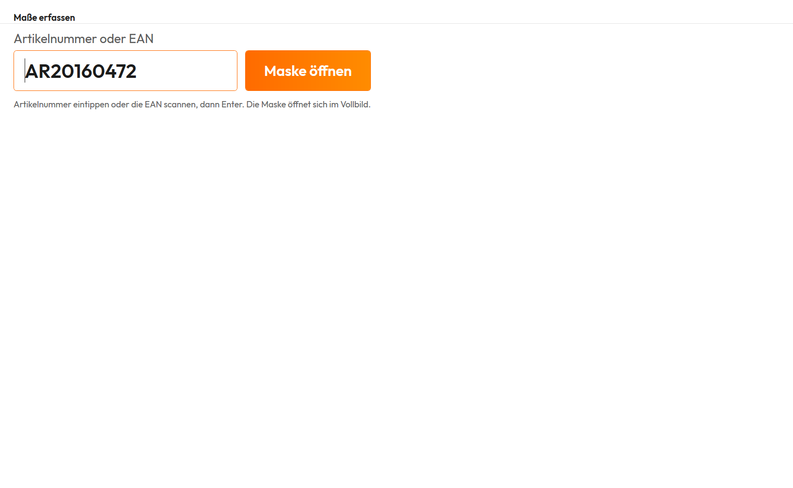

# Dokumentation arpaTools Metrifier

## Einleitung

Metrifier ist eine App im arpaTools Client. Sie erfasst **Länge, Breite, Höhe, Versandgewicht und
Artikelgewicht** eines Artikels dort, wo er gerade in der Hand liegt, zum Beispiel beim Verpacken. Sie
scannen die EAN oder tippen die Artikelnummer ein, eine Eingabemaske mit großen Feldern und einer
Ziffernleiste öffnet sich, und beim Speichern stehen die Werte im Artikel Ihrer JTL-Wawi. Die Maske ist
für einen Touchbildschirm gebaut, lässt sich aber genauso mit Maus und Tastatur bedienen.

Es gibt zwei Wege zur Maske:

- **In arpaTools:** über den Eintrag **Metrifier** in der Seitenleiste. Dort steht ein Suchfeld für die
  Artikelnummer oder EAN (siehe [Artikel suchen und Maske öffnen](#artikel-suchen-und-maske-öffnen)).
  Den Eintrag gibt es nur in der neuen Oberfläche. Arbeiten Sie noch in der bisherigen Oberfläche,
  wechseln Sie über den Eintrag **Jetzt zur neuen Ansicht wechseln (Beta)** in der Seitenleiste oder
  über **Jetzt wechseln** auf dem Dashboard; die neue Oberfläche öffnet sich beim nächsten Start von
  arpaTools. Der Aufruf aus einem anderen Programm funktioniert in beiden Oberflächen.
- **Von einem anderen Programm aus:** Ihre Packstation, ein Skript oder eine Scanner-Taste ruft
  arpaTools mit der Artikelnummer oder EAN auf, und die Maske öffnet sich direkt (siehe
  [Aufruf aus einem anderen Programm](#aufruf-aus-einem-anderen-programm)).

Beide Wege führen zu derselben Maske und schreiben die Werte auf dieselbe Weise in die Wawi.

## Voraussetzungen

- **Die arpaTools-Lizenz für Metrifier.** Welche Apps Ihre Lizenz enthält, sehen Sie auf der Startseite
  unter **Meine Module** (siehe [Lizenz](/doku/arpatools#lizenz)).
- **Eine Datenbankverbindung zu Ihrer JTL-Wawi** im Profil, mit dem Sie arbeiten (siehe
  [Datenbankverbindung](/doku/arpatools#datenbankverbindung)). Metrifier liest und schreibt direkt die
  Artikel dieser Wawi.
- **Empfohlen:** ein Touchbildschirm und ein Barcode-Scanner an der Station. Ein Scanner, der wie eine
  Tastatur arbeitet und nach dem Code Enter sendet, braucht keine weitere Einrichtung.

Metrifier braucht keinen fremden Dienst und kein Konto bei einem anderen Anbieter.

## Artikel suchen und Maske öffnen

Öffnen Sie in der Seitenleiste **Metrifier**. Der Bildschirm **Maße erfassen** hat ein großes Feld
**Artikelnummer oder EAN** und daneben die Schaltfläche **Maske öffnen**.



1. Tippen Sie die Artikelnummer ein oder scannen Sie die EAN in das Feld.
2. Drücken Sie Enter oder tippen Sie auf **Maske öffnen**.

Gesucht wird zuerst nach der Artikelnummer und nur dann nach der EAN, wenn kein Artikel diese
Artikelnummer trägt. Die Artikelnummer ist in der Wawi eindeutig, eine EAN kann mehreren Artikeln
zugeordnet sein.

Die Maske öffnet sich nur, wenn genau ein Artikel passt. Sonst erscheint über dem Feld ein Hinweis:

- **„Kein Artikel mit dieser Artikelnummer oder EAN gefunden."** Prüfen Sie die Eingabe oder den Code.
- **„Mehrere Artikel passen zu dieser EAN. Bitte die Artikelnummer eingeben."** Geben Sie in diesem
  Fall die Artikelnummer ein, sie führt immer zu genau einem Artikel.

Nachdem Sie die Maske geschlossen haben, gespeichert oder abgebrochen, ist das Feld wieder leer und
bereit für den nächsten Artikel. Sie können also direkt weiterscannen.

## Die Eingabemaske

Die Maske öffnet sich im Vollbild, die Taskleiste bleibt sichtbar. Oben stehen Artikelnummer und
Artikelname, darunter die fünf Felder mit den Werten, die der Artikel bisher in der Wawi hat.


| Feld | Einheit | Bedeutung |
|---|---|---|
| **Länge**, **Breite**, **Höhe** | cm | Die Abmessungen des Artikels, wie in der Wawi am Artikel. |
| **Versandgewicht** | kg | Das Gewicht, mit dem der Artikel versendet wird. |
| **Artikelgewicht** | kg | Das Gewicht des Artikels selbst. |

So geben Sie Werte ein:

- **Tippen Sie auf ein Feld**, dann ist sein ganzer Inhalt markiert. Die erste Ziffer ersetzt also den
  alten Wert, Sie müssen ihn nicht erst löschen.
- **Die Ziffernleiste** rechts schreibt in das Feld, in dem Sie gerade sind. Die Taste mit dem Pfeil
  löscht das letzte Zeichen.
- **Komma und Punkt** gelten beide als Dezimaltrenner, `0,6` und `0.6` sind derselbe Wert.
  Tausendertrennzeichen gibt es nicht.
- **Ein leeres Feld bedeutet 0.**
- Negative Werte und Werte über 1.000.000 werden nicht angenommen. Dann erscheint der Hinweis
  „Bitte in jedem Feld eine Zahl ab 0 eingeben. Leer lassen bedeutet 0."

Mit **Speichern** gehen die Werte in den Artikel und die Maske schließt sich. Mit **Abbrechen** schließt
sie sich, ohne etwas zu ändern. Mit einer Tastatur geht beides auch über Enter (Speichern) und Esc
(Abbrechen).

Gut zu wissen beim Speichern:

- **Geschrieben werden nur die Felder, die Sie geändert haben.** Speichern Sie, ohne etwas zu ändern,
  bleibt der Artikel ganz unberührt.
- **Die Wawi gleicht die neuen Werte mit Ihren Shops und Marktplätzen ab**, so wie bei einer Änderung
  am Artikel in der Wawi selbst.
- **Hat jemand den Artikel geändert, während die Maske offen war**, etwa in der Wawi an einem anderen
  Arbeitsplatz, speichert Metrifier nicht. Es erscheint der Hinweis „Der Artikel wurde inzwischen in der
  Wawi geändert oder gelöscht. Bitte die Maske schließen und neu öffnen." So überschreibt die Maske
  keine Änderung, die Sie nicht gesehen haben. Öffnen Sie den Artikel neu und geben Sie die Werte noch
  einmal ein.
- **Klappt das Speichern nicht**, bleibt die Maske mit Ihren Eingaben offen, und es erscheint der
  Hinweis „Die Maße konnten nicht gespeichert werden. Der Fehler steht im Protokoll." Den Eintrag finden
  Sie im Anwendungsprotokoll (siehe
  [Einstellungen und Anwendungsprotokoll](/doku/arpatools#einstellungen-und-anwendungsprotokoll)).

## Aufruf aus einem anderen Programm

Dieser Abschnitt richtet sich an die Person, die Ihre Packstation oder Ihren Ablauf einrichtet. Statt
den Artikel in arpaTools zu suchen, kann ein anderes Programm die Maske für einen bestimmten Artikel
direkt öffnen: die Software einer Packstation, ein Skript oder eine Taste am Scanner.

```
"C:\Pfad\zu\ArpaTools.exe" -profile "Profile1" -appName "Metrifier" -sku "AR2016041-001"
"C:\Pfad\zu\ArpaTools.exe" -profile "Profile1" -appName "Metrifier" -ean "0123456706570"
```

| Angabe | Pflicht | Bedeutung |
|---|---|---|
| `-profile` | ja | Das Profil, mit dem gearbeitet wird. Gemeint ist der **Ordnername** des Profils, etwa `Profile1`, nicht der Name, der in arpaTools angezeigt wird. Die Profilordner liegen unter `C:\ProgramData\arpaTools\arpaTools`. |
| `-appName` | ja | Immer `Metrifier`. |
| `-sku` | eines von beiden | Die Artikelnummer. |
| `-ean` | eines von beiden | Die EAN. |

- **Es öffnet sich nur bei genau einem Treffer etwas.** Findet sich kein Artikel oder passen mehrere,
  öffnet sich kein Fenster, und arpaTools schreibt eine Zeile ins Anwendungsprotokoll. Dasselbe gilt,
  wenn weder `-sku` noch `-ean` angegeben ist oder die Lizenz Metrifier nicht enthält.
- **Sind `-sku` und `-ean` beide angegeben, gilt die Artikelnummer**, weil sie in der Wawi eindeutig ist.
- **Werte mit Leerzeichen** gehören in Anführungszeichen.
- **Der Aufruf endet erst, wenn die Maske geschlossen ist.** Soll Ihr Programm darauf warten, starten Sie
  arpaTools wartend, in PowerShell zum Beispiel mit `Start-Process ... -Wait`, in der Eingabeaufforderung
  mit `start /wait`. Ob gespeichert oder abgebrochen wurde, meldet der Aufruf nicht zurück; wer das
  wissen muss, liest den Artikel danach in der Wawi.
- **Ein Fehler beendet den Aufruf mit einem Fehlercode ungleich 0**, zum Beispiel wenn die Datenbank
  nicht erreichbar ist oder das Profil nicht existiert. „Kein Artikel gefunden" ist dagegen kein Fehler
  und endet mit 0.
- **Jeder Aufruf startet arpaTools vollständig**, einschließlich der Lizenzprüfung. Das dauert ein paar
  Sekunden. Ist der Lizenzserver nicht erreichbar, öffnet sich die Maske nicht.
- **Mehrere Aufrufe kurz hintereinander** öffnen mehrere Masken übereinander. Schließen Sie die Maske
  eines Artikels, bevor Sie den nächsten scannen.

Ein Beispiel für PowerShell, das wartet, bis die Maske geschlossen ist:

```powershell
$p = Start-Process "C:\Pfad\zu\ArpaTools.exe" -Wait -PassThru `
  -ArgumentList '-profile "Profile1" -appName "Metrifier" -ean "0123456706570"'
$p.ExitCode
```

## Gut zu wissen

- **Varianten und Stücklisten** behandelt Metrifier wie jeden anderen Artikel: geändert wird genau der
  Artikel, zu dem die Artikelnummer oder EAN gehört.
- **Das Änderungsdatum des Artikels** setzt Metrifier nicht. Wenn Sie Auswertungen oder Exporte nach dem
  Änderungsdatum filtern, tauchen Artikel, deren Maße Sie nur in Metrifier geändert haben, dort nicht auf.
- **Zugriffsschutz:** Ist in Ihrem Profil der Zugriffsschutz eingeschaltet und für Metrifier eine
  Anmeldung verlangt, fragt arpaTools beim Öffnen des Eintrags in der Seitenleiste nach der
  JTL-Wawi-Anmeldung (siehe [Zugriffsschutz](/doku/zugriffsschutz)). Der Aufruf aus einem anderen
  Programm fragt nicht danach.