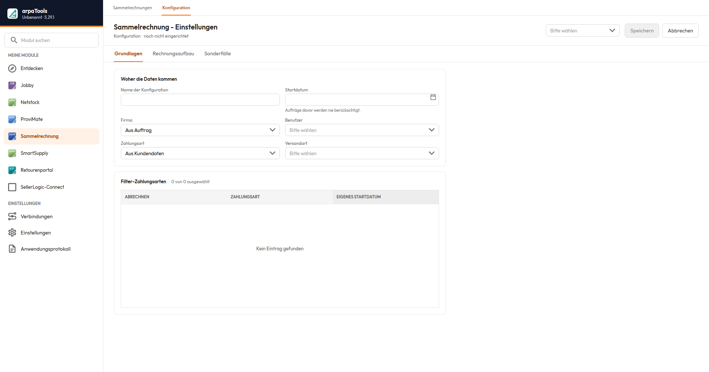
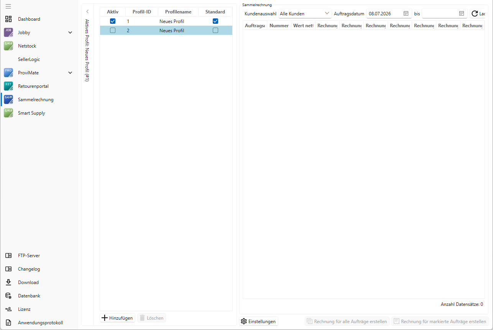

# Dokumentation arpaTools Sammelrechnung

Mit arpaTools Sammelrechnung erstellen Sie per Klick oder automatisiert Sammelrechnungen für JTL-Wawi.
Sammelrechnung ist eine App im arpaTools Client.

## Installation

Voraussetzungen:
- JTL-Wawi (ab Version 1.6.38.1)
- arpaTools Installationspaket
- eine gültige Lizenz
- Datenbank-Verbindungsparameter
- Port 21500 TCP in der Firewall freigegeben
- installiertes .NET Framework 4.8.1

Nach dem Kauf erhalten Sie eine E-Mail mit dem Downloadpaket und einem Lizenzschlüssel. Der
Lizenzschlüssel ist nur in Verbindung mit der bei der Bestellung angegebenen Mailadresse gültig. Je
Mandant wird eine eigene Lizenz benötigt; für einen weiteren Mandanten wird arpaTools in ein weiteres
Verzeichnis entpackt.

## Konfiguration

Starten Sie den arpaTools Client und öffnen Sie die App Sammelrechnung. Beim ersten Start bestätigen
Sie die Lizenzbestimmungen. Anschließend konfigurieren Sie die App für den laufenden Betrieb.

### Datenbankeinstellungen

Öffnen Sie oben rechts **Einstellungen** und den Menüpunkt **Datenbank**.

- **Server:** Pfad zum Datenbankserver. Gehostet: `Host\Instanzname` (z. B. `localhost\JTLWAWI`). Lokal oder im Netzwerk: `Host\Instanzname,Port` (z. B. `xxxx.private.ecomdata.cloud\JTLWAWI,50000`).
- **Benutzername:** Datenbankbenutzer mit Lese- und Schreibrechten.
- **Passwort:** das zugehörige Passwort.

Klicken Sie auf **Mandanten laden**, wählen Sie im Dropdown **Datenbank** eine Datenbank, prüfen Sie
mit **Einstellungen prüfen** und bestätigen Sie mit **Speichern**.

### Lizenz

Unter **Einstellungen** und **Lizenz** tragen Sie **Lizenz-Mailadresse** (die Mailadresse aus der
Bestellung) und **Lizenzschlüssel** ein. Schlägt **Lizenz prüfen** fehl, prüfen Sie zuerst, ob Port
21500 in der Firewall freigegeben ist.

### Programmeinstellungen

Unter **Konfiguration**, Registerkarte **Grundlagen**:

- **Startdatum verwenden:** legt fest, ab welchem Zeitpunkt Sammelrechnung beginnt. Setzen Sie dieses Datum, wenn Sie von einer anderen Abrechnungsart umsteigen.
- **Zahlungsart:** hat mehrere Auswirkungen:
  - wird zur Erstellung der Sammelrechnung verwendet,
  - für kundenabhängig unterschiedliche Zahlungsarten wählen Sie „Aus Kundendaten" und hinterlegen die Zahlungsart je Kunde,
  - nach Erstellung werden alle zusammengefassten Aufträge als bezahlt markiert (Zahlart aus der Konfiguration), jede Zahlung erhält die Anmerkung „Abgerechnet über Sammelrechnung <Rechnungsnummer>",
  - abgerechnete Aufträge gelten als extern abgerechnet; für sie kann keine Rechnung mehr erzeugt werden.

### Versandart

Bei der Erstellung wird in JTL-Wawi ein Sammelauftrag und eine Sammelrechnung angelegt. Die im Dropdown
gewählte **Versandart** wird den neuen Vorgängen zugewiesen.

### Benutzer

Der im Dropdown gewählte **Benutzer** wird den neu erstellten Vorgängen zugewiesen.

### Firma

Die im Dropdown gewählte **Firma** wird den neuen Vorgängen zugewiesen. Mit der Option **Firma aus
Auftrag** wird die Firma aus den Ursprungsaufträgen übernommen.

> Beachten Sie: „Firma aus Auftrag" funktioniert nur korrekt, wenn alle Ursprungsaufträge dieselbe Firma haben. Andernfalls wird pro Firma eine eigene Sammelrechnung erstellt.

### Positionsnamen bearbeiten

Unter **Konfiguration**, Registerkarte **Rechnungsaufbau**, legen Sie mit dem Schalter
**Positionsnamen bearbeiten** selbst fest, wie die Positionen in der Sammelrechnung heißen. Ist er
aus, setzt arpaTools den Namen aus Artikelname, Auftragsnummer, Auftragsdatum und, falls vorhanden,
der externen Auftragsnummer zusammen, bei Retouren aus Artikelname, Retourennummer und
Retourendatum.

Mit **Regelsatz** wählen Sie, wofür Ihre eigenen Namen gelten:
- Ja, Auftrag und Retoure
- Ja, nur Auftrag
- Ja, nur Retoure

Für jeden gewählten Teil erscheint ein Eingabefeld, **Positionsname Auftrag** und **Positionsname
Retoure**, und darunter die Liste der verfügbaren Felder. Ein Doppelklick auf ein Feld setzt seinen
Platzhalter an der Stelle ein, an der der Cursor im Eingabefeld zuletzt stand; markierter Text wird
dabei ersetzt. Haben Sie noch nicht in das Eingabefeld geklickt, hängt arpaTools den Platzhalter mit
einem Leerzeichen hinten an. Freitext schreiben Sie direkt dazwischen, zum Beispiel
`<Positionsname> aus Auftrag <Auftragsnummer>`. Beim Abrechnen ersetzt arpaTools jeden Platzhalter in
spitzen Klammern durch den Wert der jeweiligen Position.

Für Auftragspositionen stehen zur Verfügung: Auftragsnummer, Externe Auftragsnummer, Auftragsdatum,
Positionsnummer, Artikelnummer, Positionsname und alle eigenen Felder des Auftrags. Ein eigenes Feld
erscheint mit dem Wert, den der Auftrag in JTL-Wawi dafür hat; hat er keinen, bleibt die Stelle leer.
Zahlen stehen mit Dezimalkomma, Preise mit zwei Nachkommastellen, Datumsfelder als TT.MM.JJJJ.
Für Retourenpositionen stehen zur Verfügung: Externe Auftragsnummer, Retourennummer, Retourendatum,
Positionsnummer, Artikelnummer und Positionsname.

**Lieferscheinfelder.** Rechnen Sie nach Lieferscheinen ab (siehe „Abrechnungsgrundlage“), bietet die
Liste für Auftragspositionen zusätzlich **Lieferscheinnummer**, **Lieferscheindatum** und
**Versanddatum** an. So sehen Sie bei Teillieferungen auf der Rechnung, aus welcher Lieferung eine
Position stammt. Das Lieferscheindatum ist der Tag, an dem der Lieferschein in JTL-Wawi erstellt
wurde, das Versanddatum der Tag, an dem er versendet wurde. Beide können auseinanderliegen, etwa
wenn eine Lieferung erst Tage nach dem Lieferschein das Haus verlässt; wählen Sie das Datum, das
Ihre Kunden auf dem Lieferschein oder der Sendungsverfolgung wiederfinden.
Versand-, Frei- und Rabattpositionen tragen die Angaben des Lieferscheins, mit dem sie abgerechnet
werden. Bei der Abrechnung nach Aufträgen fehlen diese drei Felder in der Liste; stehen sie trotzdem
im Positionsnamen, bleiben sie leer.

**Beispiel mit Teillieferungen.** Ein Auftrag über 100 Schrauben geht in zwei Lieferungen raus, 60
Stück am 6. Oktober und 40 Stück am 9. Oktober. Mit dem Muster aus dem Bild,
`<Positionsname> / Lieferschein <Lieferscheinnummer> vom <Versanddatum>`, der Abrechnung nach
Lieferscheinen und der Abrechnungsart „Positionen auflisten“ stehen auf der Sammelrechnung zwei
Positionen, jede mit der Menge ihrer Lieferung:

- Schraube / Lieferschein LS-1001 vom 06.10.2026
- Schraube / Lieferschein LS-1002 vom 09.10.2026

Die Lieferscheinnummern sind hier ausgedacht; auf Ihrer Rechnung stehen die Nummern aus JTL-Wawi.
Werden beide Lieferungen in verschiedenen Läufen abgerechnet, steht jede Position auf der
Sammelrechnung ihres Laufs.

### Abrechnungsgrundlage

Unter **Konfiguration**, Registerkarte **Rechnungsaufbau**, legen Sie mit **Abrechnungsgrundlage**
fest, was in die Sammelrechnung kommt:

- **Aufträge** (Standard): Ein Auftrag kommt in die Sammelrechnung, sobald er versendet ist, und wird
  mit ihr vollständig abgerechnet. So arbeitet die Sammelrechnung, wenn Sie nichts umstellen.
- **Lieferscheine:** Jeder versendete Lieferschein kommt einzeln in die Sammelrechnung, mit den
  Mengen, die tatsächlich geliefert wurden. Liefern Sie einen Auftrag in mehreren Teilen, rechnet
  jeder Lauf die Teile ab, die bis dahin versendet sind. Sie müssen also nicht warten, bis der ganze
  Auftrag geliefert ist. Welche Lieferung eine Position abrechnet, können Sie im Positionsnamen
  ausweisen, siehe „Positionsnamen bearbeiten“.

**Der Umschalttag.** Wenn Sie auf Lieferscheine umstellen, merkt sich arpaTools den Tag. Abgerechnet
werden danach nur Aufträge, deren erster Lieferschein ab diesem Tag entstanden ist. So holt der erste
Lauf nicht auf einmal jeden älteren Lieferschein nach. Aufträge, deren erster Lieferschein vor dem
Umschalttag entstand, rechnet diese Konfiguration nicht mehr ab. Stellen Sie deshalb am besten um,
wenn die älteren Aufträge abgerechnet sind. Ein erneutes Speichern verschiebt den Umschalttag nicht.
Stellen Sie zurück auf Aufträge, wird er gelöscht.

**Was im Ursprungsauftrag geschieht.** Mit jeder Teilabrechnung bucht arpaTools den abgerechneten
Betrag im Ursprungsauftrag als Ausgleich gegen, damit dort kein falscher offener Betrag stehen bleibt.
Im eigenen Feld `arpa_lieferscheine_zu_auftrag` sehen Sie, welche Lieferung auf welcher
Sammelrechnung steht. Die Rechnungsnummer in `arpa_rechnungsnummer` und die Zahlung bekommt der
Auftrag erst, wenn er vollständig abgerechnet ist.

**Wann ein Auftrag als vollständig abgerechnet gilt.** Wenn beides zutrifft:

- Er ist in JTL-Wawi komplett ausgeliefert oder ohne Versand abgeschlossen.
- Kein Lieferschein des Auftrags steht mehr aus, auch keiner, der erst noch versendet wird.

Bis dahin bleibt er teilabgerechnet, und weitere Lieferungen kommen mit späteren Läufen in die
Sammelrechnung. Wird ein Auftrag fertig, ohne dass noch eine Lieferung kommt, schließt arpaTools ihn
beim nächsten Lauf ab, auch wenn dieser Lauf für den Kunden nichts abrechnet. Das passiert zum
Beispiel, wenn Sie eine Restmenge streichen, den Auftrag ohne Versand abschließen oder die letzte
Lieferung gutschreiben.

- **Gutgeschriebene Lieferungen:** Ist die Ware eines Lieferscheins vollständig gutgeschrieben, kommt
  er nicht in die Sammelrechnung und hält den Auftrag auch nicht offen.
- **Rechnung aus JTL-Wawi:** Hat JTL-Wawi selbst eine Rechnung zu einem Auftrag erstellt, schließt
  arpaTools ihn nicht ab. Solche Aufträge prüfen Sie bitte von Hand.
- **Geänderte Zahlungsart:** Kommt eine versendete Lieferung nicht mehr in die Auswahl, weil Sie nach
  einer Teilabrechnung die Zahlungsart des Auftrags oder die Filter-Zahlungsarten geändert haben,
  schließt arpaTools den Auftrag nicht ab. Er bleibt teilabgerechnet, damit keine Zahlung über Ware
  gebucht wird, die nie berechnet wurde. Solche Aufträge prüfen Sie bitte ebenfalls von Hand.
- **Abgebrochener Lauf:** Bricht ein Lauf ab, bevor die Sammelrechnung angelegt ist, kommen seine
  Lieferscheine beim nächsten Lauf wieder in die Auswahl. Gelingt auch dieses Freigeben nicht, nennt
  das Anwendungsprotokoll die betroffenen Lieferscheine. Sie erscheinen dann erst wieder, wenn ihre
  Reservierung von Hand entfernt ist; wenden Sie sich dafür an den Support.

### Versandposition übernehmen

„Nein" überträgt die Versandkostenposition nicht in die Sammelrechnung. „Ja" übernimmt die Versandkosten
des ursprünglichen Auftrags.

### Lieferungen abrechnen

„Ja" rechnet die Versandkosten des Ursprungsauftrags je Lieferung ab, nicht nur einmal je Auftrag.
Die Menge der Versandposition entspricht der Zahl der Lieferscheine mit Versand zu diesem Auftrag.
Wurde ein Auftrag in zwei Lieferungen verschickt, stehen die Versandkosten zweimal in der
Sammelrechnung. Maßgeblich ist die Lieferung, nicht das Paket: Eine Lieferung, die in mehreren
Paketen verschickt wurde, zählt einmal.

„Lieferungen abrechnen" lässt sich nur einschalten, wenn „Versandposition übernehmen" auf „Ja" steht.

Steht die [Abrechnungsgrundlage](#abrechnungsgrundlage) auf **Lieferscheine**, gilt:

- **Ja:** Jede Sammelrechnung trägt die Versandkosten für die Lieferungen, die sie abrechnet.
- **Nein:** Die Versandkosten kommen einmal je Auftrag, mit der Sammelrechnung, die seine erste
  Lieferung abrechnet.

Ein Beispiel: Versandkosten 4,90 €, Lieferungen am 1. und am 5., Läufe am 3. und am 7. Bei „Ja“
enthält jede der beiden Sammelrechnungen einmal 4,90 €. Bei „Nein“ enthält die vom 3. die 4,90 €, die
vom 7. keine Versandkosten.

### Retouren verarbeiten

Aufträge, die nach Erstellung einer Sammelrechnung retourniert wurden, werden bei der nächsten
Sammelrechnung berücksichtigt und zum Abzug gebracht. Da es für einen Ursprungsauftrag keine Rechnung
gibt, kann keine Rechnungskorrektur angelegt werden. Damit dennoch erstattet werden kann, werden die
Retourenpositionen zum Ursprungsauftrag in der Sammelrechnung abgezogen. Das sorgt für einen sauberen
buchhalterischen Prozess.

**Stücklisten** werden nur als ganzes Set gutgeschrieben, zum Preis, Rabatt und Steuersatz, zu dem
das Set verkauft wurde. Das entspricht JTL-Wawi, die einzelnen Teilen einer Stückliste keinen eigenen
Wert gibt. Enthält eine Retoure nur einzelne Teile eines Sets, bleibt sie offen und kommt mit keiner
ihrer Positionen in die Sammelrechnung. Das Anwendungsprotokoll nennt die Retoure und die fehlenden
Teile. Sobald die Retoure das ganze Set enthält, wird sie beim nächsten Lauf abgerechnet. Über alle
Retouren wird nie mehr gutgeschrieben, als verkauft wurde: Wurden das Set selbst und seine einzelnen
Teile in verschiedenen Retouren zurückgebucht und kämen dadurch mehr Sets zurück als verkauft, bleibt
die Retoure offen. Solche Retouren prüfen Sie von Hand.

### Retourenstatus

Im Feld **Retourenstatus** legen Sie fest, in welchem Status eine Retoure sein muss, um in der nächsten
Sammelrechnung erfasst zu werden.

> Tipp: Legen Sie mehrere Retourenstatus an, um zu unterscheiden, ob eine Retoure abgezogen werden soll. Retouren, die erstattet werden sollen, erhalten den in der Konfiguration hinterlegten Status; alle anderen bleiben unberücksichtigt. Den Status können Sie jederzeit ändern.

### Rechnung erstellen

Legt global fest, ob beim Erstellen eines Sammelrechnungsauftrags sofort eine Rechnung erzeugt wird,
ohne JTL-Workflow.

### Abrechnungsart

Wie detailliert die Sammelrechnungsaufträge erstellt werden:
- **Positionen auflisten** (Standard): jede einzelne Position mit Menge erscheint in der Sammelrechnung.
- **Aufträge abrechnen:** nur die Kosten je versendetem Auftrag werden aufgenommen.
- **Einzelaufstellung als CSV-Datei:** im Sammelrechnungsauftrag erscheint nur eine Position, und es wird eine CSV-Datei mit der Auftragsnummer als Dateinamen erzeugt. Ablage: `%AppData%\arpaTools\Sammelrechnung\Profile1\Export`. Bei mehreren Profilen ist der Profilname im Pfad anzupassen.

Da die CSV die Auftragsnummer als Namen trägt, kann sie über einen JTL-Workflow per Mail versendet
werden. Beispielpfad für den Anhang:
`C:\Users\<Benutzer>\AppData\Roaming\arpaTools\Sammelrechnung\Profile1\Export\{{ Vorgang.Stammdaten.Auftragsnummer }}.csv`.
`{{ Vorgang.Stammdaten.Auftragsnummer }}` ist die DotLiquid-Variable der Auftragsnummer.

### Unteroption „Kostenfreie Positionen"

Optionen: Auflisten (Standard) oder Nicht auflisten. Nur aktiv, wenn die Abrechnungsart
„Einzelaufstellung als CSV" gewählt ist. Steuert, ob Positionen mit einem Betrag von 0 € in der
CSV-Datei erscheinen.

### Ohne Versand abgeschlossene Aufträge

Aufträge, die ohne Versand abgeschlossen sind, können optional mit abgerechnet werden.

- **Nein:** Es erscheinen nur Aufträge, die versendet wurden. Ein ohne Versand abgeschlossener Auftrag
  bleibt aus der Liste.
- **Alle:** Ohne Versand abgeschlossene Aufträge erscheinen zusätzlich in der Liste, unabhängig vom
  Auftragsdatum. Sie brauchen dafür keinen Versand und kein Versanddatum.
- **Eingeschränkt:** wie „Alle", aber nur für Aufträge, die ab dem eingestellten Datum („Ab
  einschließlich") angelegt wurden.

Aufträge, die als komplett ausgeliefert gelten, aber nie versendet wurden, erscheinen bei keiner
dieser Einstellungen.

> Vorsicht: Wenn Sie bei Abrechnen „Alle" wählen, werden alle ohne Versand abgeschlossenen Aufträge aufgeführt, für die keine Rechnung erstellt wurde und die auf die Zahlungsfilter passen. Im Zweifel nur eingeschränkt abrechnen und das aktuelle Datum einstellen.

### Filter-Zahlungsarten

Die ausgewählten Zahlungsarten werden zur Suche der Aufträge herangezogen. Die JTL-Option „Auslieferung
vor Zahlungseingang möglich" muss aktiviert sein. Optional kann jede Zahlungsart ab einem bestimmten
Datum aktiviert werden, sodass ältere Aufträge nicht abgerechnet werden.

**Auslieferung vor Zahlungseingang möglich:** ermöglicht in JTL-Wawi den Versand nicht bezahlter
Aufträge. In JTL-Wawi unter Zahlungen und Zahlungsarten eine Zahlungsart (z. B. „Sammelrechnung")
anlegen und die Option aktivieren.

> Es werden nur Zahlungsarten mit der Option „Auslieferung vor Zahlungseingang möglich" angezeigt und verwendet.

## Eigene Felder

Für den Betrieb werden eigene Felder für Aufträge und Kunden angelegt.

### Eigenes Feld im Kundenstamm

**arpa_intervall:** legt je Kunde fest, in welchem Intervall automatisch Sammelrechnungen erzeugt werden.
Verfügbare Intervalle:
- Manuell (keine automatische Erzeugung)
- Täglich
- Jeden Freitag
- 10. des Monats
- 20. des Monats
- Ende des Monats

Die automatische Erzeugung übernimmt heute die **Jobby-Aktion Sammelrechnung** (siehe
[Jobby-Dokumentation](/doku/jobby)). Sie prüft je Kunde das eingestellte Intervall und erzeugt fällige
Sammelrechnungen. Ein separater Aufruf einer eigenständigen Anwendung ist dafür nicht mehr nötig.

> Tipp: Über die Oberfläche lassen sich Sammelrechnungen jederzeit und ohne Rücksicht auf das Intervall erzeugen.

### Eigenes Feld im Auftrag

- **arpa_rechnungsnummer:** nach Erzeugen einer Sammelrechnung wird in allen Ursprungsaufträgen die Rechnungsnummer der Sammelrechnung hinterlegt. Ist das Feld gefüllt, wird der Auftrag bei neuen Sammelrechnungen nicht mehr berücksichtigt. Leeren Sie das Feld, wird er wieder berücksichtigt.
- **arpa_ist_sammelrechnung:** Checkbox, die gesetzt wird, wenn es sich um eine Sammelrechnung handelt.

## Plattform Sammelrechnung

Nach der Installation wird eine Plattform namens `arpa_Sammelrechnung` angelegt. Über sie finden Sie
Sammelaufträge und Sammelrechnungen schnell wieder und können in der JTL-Statistik danach filtern.

## Programmablauf

Öffnen Sie die App Sammelrechnung. Links zeigt **Konfigurationen**, wie viele Konfigurationen angelegt
sind; über **Neu** entsteht die erste, **Duplizieren** übernimmt eine bestehende als Vorlage,
**Als Standard** legt die Vorauswahl fest, **Löschen** entfernt eine Konfiguration.

Standardmäßig ist im Dropdown **Alle Kunden** gewählt; angezeigt werden alle Kunden mit der in der
Konfiguration festgelegten Zahlungsart. Für einen bestimmten Kunden wählen Sie diesen aus. Sie können
die Aufträge zusätzlich auf einen Zeitraum begrenzen; ein konfiguriertes Startdatum wird übernommen.
Klicken Sie auf **Aufträge laden**.

- **Alle markieren:** markiert alle angezeigten Aufträge.
- **Rechnung erstellen:** erstellt Sammelrechnungen für die markierten Aufträge.

> nicht bestätigt; vermutlich ein Schnellweg, der markieren und erstellen in einem Schritt zusammenfasst.

In der Liste erscheinen alle Aufträge, die infrage kommen. Bedingungen: die konfigurierte Zahlungsart,
der Status **Verpackt und Versendet**, und das leere Feld `arpa_rechnungsnummer`. Andere Lieferstatus
(Teilgeliefert, Ausstehend, Lieferschein erstellt) werden nicht berücksichtigt.

Steht die [Abrechnungsgrundlage](#abrechnungsgrundlage) auf **Lieferscheine**, zeigt die Liste
stattdessen die versendeten Lieferscheine, die noch nicht abgerechnet sind, auch die von teilweise
gelieferten Aufträgen. Schritt 1 ermittelt dann die gelieferten Positionen dieser Lieferscheine statt
aller Auftragspositionen. Die Schritte 6 und 7 unten führt arpaTools erst aus, wenn der Auftrag
vollständig abgerechnet ist.

Beim Erzeugen werden mehrere Schritte ausgeführt:
1. Alle Auftragspositionen der infrage kommenden Aufträge werden ermittelt.
2. Retouren zu früheren Aufträgen werden ermittelt (abhängig vom konfigurierten Retourenstatus).
3. Auftrags- und abzuziehende Retourenpositionen werden in einen neuen Auftrag zusammengefasst.
4. Der neue Auftrag erhält den Lieferstatus „Ohne Versand abgeschlossen".
5. Zum neuen Auftrag wird eine Rechnung erzeugt.
6. Alle Ursprungsaufträge erhalten im Feld `arpa_rechnungsnummer` die neue Rechnungsnummer.
7. Alle Ursprungsaufträge werden mit der konfigurierten Zahlart als bezahlt markiert, mit Anmerkung „Mit Sammelrechnung <Rechnungsnummer> verrechnet".

Eine Sammelrechnung wird nach diesen Kriterien zusammengefasst: Firma, Versandland, USt-IdNr.,
Kunden-ID, Sprache, Währung, Rechnungsadresse. Unterscheiden sich diese bei markierten Aufträgen eines
Kunden, werden getrennte Sammelrechnungen erstellt.

> Hinweis zur Technik: Ab JTL-Wawi 2.0 wird die Sammelrechnung direkt in der Datenbank erzeugt. Bis JTL-Wawi 1.11 erfolgt die Erstellung über die Komponente JtlWawiExtern.dll, die dafür vorhanden sein muss.

Auftrags- und Rechnungsnummern vergibt die JTL-Wawi. Legt im selben Moment jemand im Haus einen Beleg
an, ist diese Nummernvergabe kurz belegt. arpaTools versucht es dann bis zu dreimal mit kurzer Pause.
Bleibt sie belegt, erscheint die Meldung „Die JTL-Wawi ist gerade ausgelastet"; die
betroffene Sammelrechnung wird dann nicht angelegt, bereits angelegte bleiben bestehen. Die
Auftragsliste wird danach geleert, ebenso nach jedem anderen Fehler während des Laufs. Laden Sie die Aufträge nach ein paar Minuten neu und starten Sie
den Lauf noch einmal; bereits abgerechnete Aufträge erscheinen dann nicht mehr.
Bis JTL-Wawi 1.11 vergibt die Komponente JtlWawiExtern.dll die Rechnungsnummer selbst. Ist die
Nummernvergabe in diesem Moment belegt, bricht der Lauf dort wie bisher mit einer allgemeinen
Fehlermeldung ab; auch dann die Aufträge später neu laden und den Lauf wiederholen.

① Neu — legt die erste Konfiguration an. ② Aufträge laden — zeigt die passenden Aufträge im
gewählten Zeitraum. ③ Alle markieren — markiert alle angezeigten Aufträge. ④ Rechnung erstellen —
erstellt Sammelrechnungen für die markierten Aufträge.