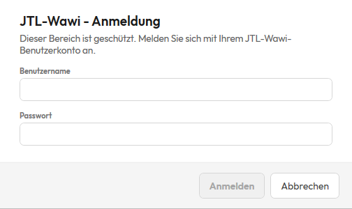

# Dokumentation arpaTools Zugriffsschutz

## Einleitung

Mit dem Zugriffsschutz legen Sie fest, wer an einem Arbeitsplatz welche Bereiche von arpaTools öffnen
darf. Ein geschützter Bereich, etwa ProviMate oder die Einstellungen, öffnet sich erst nach einer
Anmeldung mit den Zugangsdaten aus Ihrer JTL-Wawi. Welche Wawi-Benutzer in welchen Bereich dürfen,
bestimmt ein JTL-Wawi-Administrator in einer Tabelle, in der alle Benutzer und alle Bereiche auf einen
Blick stehen.

Die Einstellung gilt für die JTL-Wawi-Datenbank, nicht für einen einzelnen Rechner: Sie richten den
Schutz einmal ein, und er greift an jedem Arbeitsplatz, der mit derselben Wawi-Datenbank arbeitet.

## Was der Zugriffsschutz leistet und was nicht

Der Zugriffsschutz regelt, wer in der Oberfläche von arpaTools welche Bereiche öffnet. Er hält
Mitarbeiter aus Bereichen heraus, die nicht zu ihrer Arbeit gehören, zum Beispiel aus der
Provisionsabrechnung oder aus den Einstellungen mit der Datenbankverbindung. Ein Schutz Ihrer Daten
gegen jemanden, der ihn gezielt umgehen will, ist er nicht:

- **Arbeitsplätze mit einer älteren arpaTools-Version** kennen den Zugriffsschutz nicht und öffnen jeden
  Bereich ohne Anmeldung. Bringen Sie deshalb alle Arbeitsplätze auf den aktuellen Stand, bevor Sie
  sich auf den Schutz verlassen.
- **Wer Zugang zur Datenbank selbst hat**, etwa über die SQL-Zugangsdaten, liest und ändert die Daten
  ohne arpaTools.
- **Wer Jobby öffnen darf**, kann dort Aktionen aller Module anlegen und ausführen, auch von Modulen,
  die für ihn geschützt sind. Geben Sie Jobby deshalb nur Benutzern frei, denen Sie auch die übrigen
  Module anvertrauen.
- **Ist die Datenbank beim Start nicht erreichbar**, greift der Schutz nicht, damit sich die
  Verbindung in den Einstellungen reparieren lässt (siehe [Gut zu wissen](#gut-zu-wissen)).

## Voraussetzungen

- **Die neue Oberfläche von arpaTools.** Den Zugriffsschutz gibt es nur dort. Arbeiten Sie noch in der
  bisherigen Oberfläche, wechseln Sie über den Eintrag **Jetzt zur neuen Ansicht wechseln (Beta)** in
  der Seitenleiste oder über **Jetzt wechseln** auf dem Dashboard; die neue Oberfläche öffnet sich beim
  nächsten Start von arpaTools.
- **Ein Benutzerkonto in JTL-Wawi mit Administratorrechten**, um den Schutz ein- und auszuschalten und
  die Freigaben zu pflegen. Als Administrator gilt, wer in JTL-Wawi einer Benutzergruppe mit
  Administratorrechten angehört oder das Recht **Benutzer / Rechte** hat.
- **Eine Datenbankverbindung zu Ihrer JTL-Wawi** im Profil (siehe
  [Datenbankverbindung](/doku/arpatools#datenbankverbindung)). Die Benutzer und Kennwörter kommen aus
  dieser Wawi, und dort speichert arpaTools auch, was geschützt ist.

Für den Zugriffsschutz brauchen Sie keine eigene arpaTools-Lizenz. Der Reiter steht in jedem Profil
zur Verfügung.

## Zugriffsschutz einschalten

1. Klicken Sie unten in der Seitenleiste auf **Einstellungen** und wählen Sie den Reiter
   **Zugriffsschutz**.
2. Schalten Sie **Module mit Anmeldung schützen** ein.
3. Es öffnet sich das Fenster **JTL-Wawi - Anmeldung** mit dem Hinweis „Diese Aktion setzt ein
   JTL-Wawi-Benutzerkonto mit Administrationsrechten voraus." Geben Sie **Benutzername** und
   **Passwort** eines Wawi-Administrators ein und klicken Sie auf **Anmelden**.

Danach ist der Schutz eingeschaltet, und unter dem Schalter erscheint die Tabelle mit den Freigaben.
Beim ersten Einschalten ist nur der Bereich **Einstellungen** geschützt, alle anderen Bereiche öffnen
sich weiter für jeden. So sperren Sie mit dem Einschalten niemanden aus, und Sie entscheiden in Ruhe,
was Sie schützen möchten. Die Schlösser in der Seitenleiste erscheinen sofort, ein Neustart ist nicht
nötig.

Der Administrator, der das Einschalten bestätigt hat, ist damit angemeldet und kann die Freigaben gleich
bearbeiten.

Gehört das Konto keinem Administrator, meldet arpaTools „Der angemeldete Benutzer ist kein
JTL-Wawi-Adminbenutzer!", und das Anmeldefenster bleibt offen, damit Sie es mit einem
Administratorkonto erneut versuchen. Brechen Sie die Anmeldung ab, springt der Schalter zurück, und es
ändert sich nichts.

Jedes Ein- und Ausschalten fragt die Administrator-Anmeldung neu ab, auch wenn Sie schon angemeldet
sind.

## Freigaben festlegen

In der Tabelle unter dem Schalter steht für jeden Benutzer eine Zeile und für jeden Bereich eine Spalte.

Die Tabelle läuft nach rechts weiter, bis alle Bereiche zu sehen sind. Den Ausschnitt verschieben Sie mit
der Bildlaufleiste unter der Tabelle; die Spalte mit den Benutzern bleibt dabei stehen.

**Die Spalten** sind die Module, die Ihre Lizenz an diesem Arbeitsplatz in der Seitenleiste zeigt, dazu
die drei Einträge unten in der Seitenleiste: **Verbindungen**, **Einstellungen** und
**Anwendungsprotokoll**. **Entdecken** fehlt: arpaTools öffnet es nach jedem Start von selbst, deshalb
lässt es sich nicht schützen. Die Bereiche innerhalb eines Moduls, etwa die Abschnitte von ProviMate,
folgen ihrem Modul.

**Die Zeilen** sind die aktiven Benutzer Ihrer JTL-Wawi, mit Namen und darunter dem Anmeldenamen.
Benutzer, die in der Wawi deaktiviert sind, stehen nicht in der Tabelle und können sich auch nicht
anmelden.

So setzen Sie die Häkchen:

- **Anmeldung nötig** ② (erste Zeile): Ein Häkchen schützt den Bereich dieser Spalte. Ohne Häkchen
  öffnet er sich für jeden ohne Anmeldung. Die Häkchen der Benutzer in dieser Spalte stehen dann
  ausgegraut da, bleiben aber erhalten; setzen Sie **Anmeldung nötig** später wieder, gelten sie wie
  vorher.
- **Alle Benutzer** ③ (zweite Zeile): setzt oder entfernt das Häkchen aller Benutzer in dieser Spalte.
  Das wirkt auf die Benutzer, die die Tabelle gerade zeigt. Haben Sie über die Suche eingegrenzt, also
  nur auf die gefundenen.
- **Ein Häkchen in einer Benutzerzeile** gibt diesem Benutzer den Bereich frei. Er öffnet ihn nach
  seiner Anmeldung.
- **Das Kästchen am Zeilenanfang** wählt für diesen Benutzer alle geschützten Bereiche auf einmal an
  oder ab.
- **Benutzer suchen** ① grenzt die Tabelle auf Benutzer ein, deren Name oder Anmeldename den Suchtext
  enthält.

**Administratoren** stehen mit „immer" in jeder Spalte. Sie kommen in jeden Bereich, und das lässt sich
nicht abwählen. Wer Administrator ist, entscheidet Ihre JTL-Wawi bei jeder Anmeldung. Solange die Wawi
einen Administrator hat, kann sich also niemand aus arpaTools aussperren.

Klicken Sie zum Schluss unten auf **Speichern**. arpaTools bestätigt mit „Die Freigaben sind
gespeichert." Gespeichert werden nur die Häkchen, die Sie geändert haben, auch die von Benutzern, die die
Suche gerade ausblendet. Pflegen zwei Administratoren an verschiedenen Arbeitsplätzen gleichzeitig die
Tabelle, überschreiben sie sich deshalb nicht gegenseitig, solange sie verschiedene Häkchen ändern.
**Verwerfen** lädt den gespeicherten Stand neu und nimmt Ihre ungespeicherten Änderungen zurück.

**Nur ein angemeldeter Administrator kann die Freigaben ändern.** Ist ein anderer Benutzer angemeldet,
der die Einstellungen öffnen darf, sieht er die Tabelle nur lesend mit dem Hinweis „Nur ein angemeldeter
JTL-Wawi-Administrator kann die Freigaben ändern." Als Administrator angemeldet sind Sie, nachdem Sie den
Schutz eingeschaltet oder sich beim Öffnen eines geschützten Bereichs, etwa der Einstellungen, mit einem
Administratorkonto angemeldet haben.

## Schlösser in der Seitenleiste

Hinter dem Namen jedes geschützten Bereichs steht in der Seitenleiste ein Schloss. Es zeigt, ob Sie den
Bereich gerade öffnen können. Die Einträge **Verbindungen**, **Einstellungen** und
**Anwendungsprotokoll** unten in der Seitenleiste zeigen dasselbe Schloss.

| Anzeige | Bedeutung |
|---|---|
| kein Schloss | Der Bereich ist frei und öffnet sich für jeden ohne Anmeldung. |
| graues, geschlossenes Schloss | Der Bereich ist geschützt, und es ist noch niemand angemeldet. Beim Öffnen fragt arpaTools nach der Anmeldung. Die Kurzinfo lautet „Geschützt, Anmeldung nötig". |
| grünes, offenes Schloss | Sie sind angemeldet und dürfen den Bereich öffnen. Die Kurzinfo lautet „Freigeschaltet". |
| rotes, geschlossenes Schloss | Sie sind angemeldet, für diesen Bereich aber nicht freigegeben. Die Kurzinfo lautet „Kein Zugriff". |

Ein Administrator sieht nach seiner Anmeldung bei jedem geschützten Bereich das grüne Schloss.

## Einen geschützten Bereich öffnen

Klicken Sie auf einen Bereich mit grauem Schloss, öffnet sich das Fenster **JTL-Wawi - Anmeldung** mit
dem Hinweis „Dieser Bereich ist geschützt. Melden Sie sich mit Ihrem JTL-Wawi-Benutzerkonto an." Hier
genügt ein gewöhnliches Wawi-Benutzerkonto, Administratorrechte sind nicht nötig.

1. Geben Sie Ihren **Benutzernamen** und Ihr **Passwort** aus der JTL-Wawi ein.
2. Klicken Sie auf **Anmelden**.

Sind Sie für den Bereich freigegeben, öffnet er sich. Die Anmeldung gilt danach für alle geschützten
Bereiche, bis Sie arpaTools schließen, und alle Schlösser zeigen ihren neuen Stand. Sie melden sich also
nur einmal an, nicht bei jedem Bereich.

Sind Sie für den Bereich nicht freigegeben, steht an seiner Stelle der Hinweis „Kein Zugriff. Ein
JTL-Wawi-Administrator kann Sie für diesen Bereich freigeben." Von dem Modul selbst wird dann nichts
geladen. Wenden Sie sich an Ihren Wawi-Administrator, wenn Sie den Bereich für Ihre Arbeit brauchen.

Stimmen Benutzername oder Passwort nicht oder ist das Konto in der Wawi deaktiviert, meldet arpaTools
„Der JTL-Wawi-Benutzer konnte nicht angemeldet werden!" Mit **Abbrechen** schließen Sie das Fenster,
und arpaTools zeigt weiter den Bereich, in dem Sie vorher waren.

**Abmelden** gibt es nicht. Die Anmeldung endet, wenn Sie arpaTools schließen. Möchten Sie als anderer
Benutzer weiterarbeiten, schließen Sie arpaTools und starten Sie es neu. Auch ein Wechsel des Profils
startet arpaTools neu und beendet damit die Anmeldung.

Muss sich arpaTools neu anmelden, während ein geschützter Bereich offen ist, zum Beispiel nachdem Sie
in den Einstellungen eine andere Datenbankverbindung gespeichert haben, öffnet sich kein Fenster von
selbst. An der Stelle des Bereichs steht dann „Dieser Bereich ist geschützt. Melden Sie sich mit Ihrem
JTL-Wawi-Benutzerkonto an." mit der Schaltfläche **Anmelden**, die das Anmeldefenster öffnet.

## Zugriffsschutz ausschalten

Schalten Sie in den Einstellungen im Reiter **Zugriffsschutz** den Schalter **Module mit Anmeldung
schützen** aus und bestätigen Sie mit einem Administratorkonto, wie beim Einschalten. Danach öffnen sich
alle Bereiche wieder ohne Anmeldung, und die Schlösser verschwinden.

Ihre Einstellungen gehen dabei nicht verloren. arpaTools behält, welche Bereiche geschützt sind und wer
freigegeben ist. Schalten Sie den Schutz wieder ein, ist die Tabelle so da, wie Sie sie verlassen haben.

## Was der Zugriffsschutz nicht berührt

Der Zugriffsschutz gilt für das, was Sie in arpaTools anklicken. Was ohne die Oberfläche läuft, fragt
nicht nach einer Anmeldung:

- **Jobs, die der arpaTools-Dienst nach Zeitplan ausführt**, laufen weiter, auch mit Aktionen von
  Modulen, die geschützt sind.
- **Aufrufe von arpaTools aus einem anderen Programm**, etwa ein Job über die Kommandozeile oder die
  Metrifier-Maske von einer Packstation aus, öffnen sich ohne Anmeldung.

Das ist gewollt: Ein Job, der heute nachts läuft, soll nach dem Einschalten des Schutzes genauso
weiterlaufen wie vorher.

## Gut zu wissen

- **Die bisherige Oberfläche öffnet sich nicht mehr.** Solange der Zugriffsschutz eingeschaltet ist,
  startet arpaTools in diesem Profil immer mit der neuen Oberfläche, denn nur sie kennt die Schlösser.
  Das gilt auch, wenn **Neues Design verwenden** ausgeschaltet oder auf dem Rechner die bisherige
  Oberfläche fest eingestellt ist. Schalten Sie den Schutz aus, öffnet arpaTools beim nächsten Start
  wieder die Oberfläche, die Sie gewählt haben.
- **Änderungen wirken an allen Arbeitsplätzen beim nächsten Klick.** arpaTools liest den Schutz bei
  jedem Wechsel des Bereichs neu aus der Datenbank. Ein Bildschirm, der an einem anderen Arbeitsplatz
  gerade offen ist, bleibt offen, bis dort jemand den Bereich wechselt.
- **Ein neues Modul ist zunächst geschützt.** Kommt nach dem Einschalten ein Modul in die Seitenleiste,
  etwa durch ein Update oder eine neu gebuchte Lizenz, verlangt es eine Anmeldung, und nur
  Administratoren kommen hinein. Soll es für alle frei sein, entfernen Sie in seiner Spalte das Häkchen
  bei **Anmeldung nötig** und speichern. Sonst geben Sie es den Benutzern frei, die es brauchen.
- **Jede Wawi-Datenbank hat ihren eigenen Zugriffsschutz.** Arbeiten Sie mit mehreren Profilen für
  verschiedene Mandanten, richten Sie den Schutz in jedem Profil eigens ein. Speichern Sie in den
  Einstellungen eine andere Datenbankverbindung, endet die Anmeldung, denn sie gehörte zur bisherigen
  Datenbank.
- **Wenn die Datenbank nicht erreichbar ist.** Ohne Datenbank kann sich niemand anmelden, und die
  Verbindung muss sich in den Einstellungen reparieren lassen. Findet arpaTools die Datenbank schon beim
  Start nicht, greift der Schutz deshalb nicht; die Module selbst arbeiten ohne Datenbank ohnehin nicht.
  Fällt die Verbindung erst später aus, bleibt der zuletzt gelesene Stand bestehen, ein kurzer Aussetzer
  öffnet also nichts. Sind dabei die Einstellungen gesperrt, kommen Sie erst nach einem Neustart von
  arpaTools wieder an die Datenbankverbindung.
- **Freigaben von deaktivierten Benutzern bleiben liegen.** Aktivieren Sie einen Benutzer in der Wawi
  wieder, hat er seine Freigaben zurück.